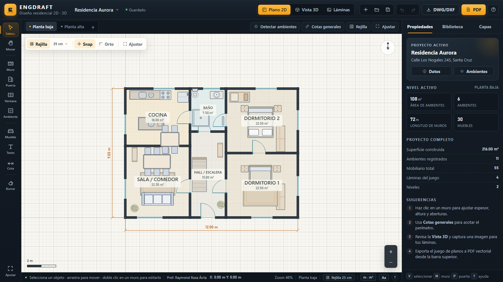
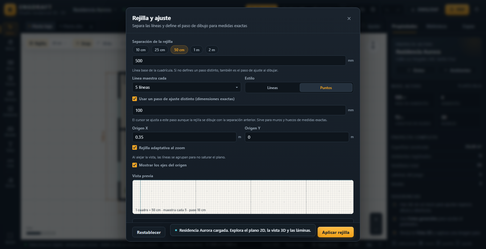
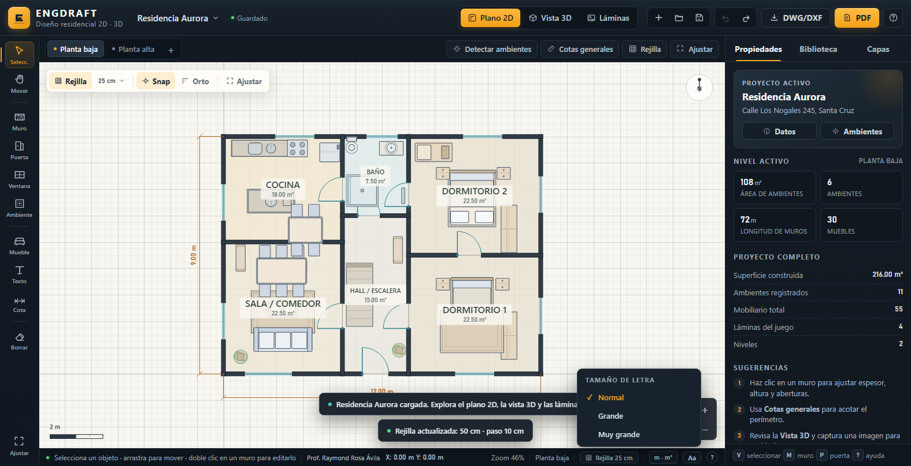
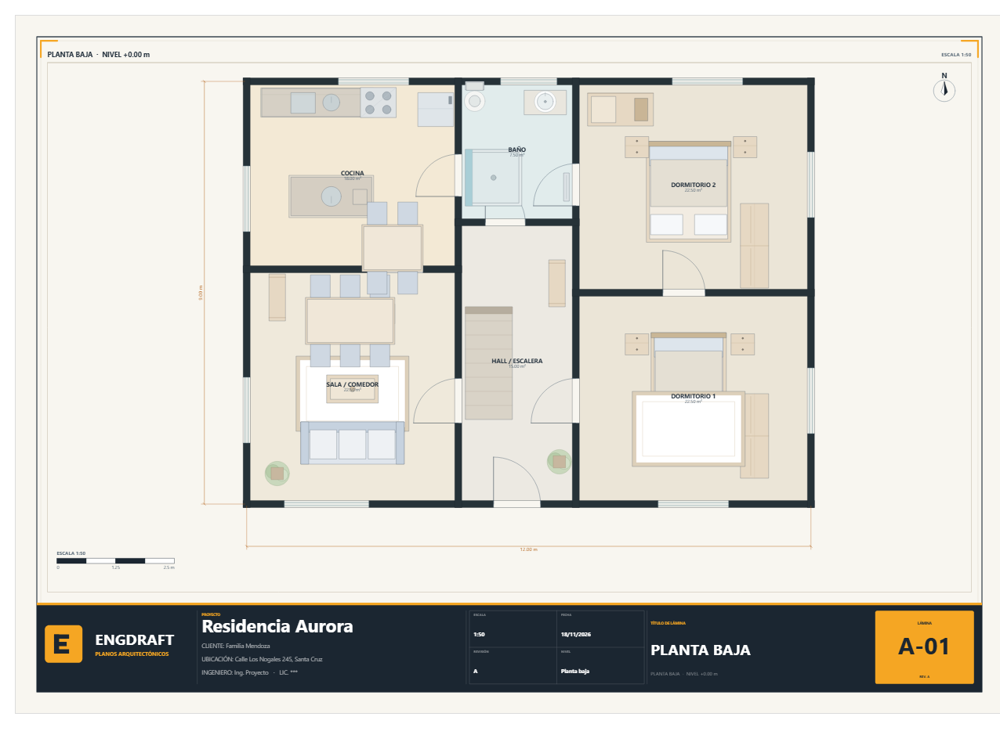
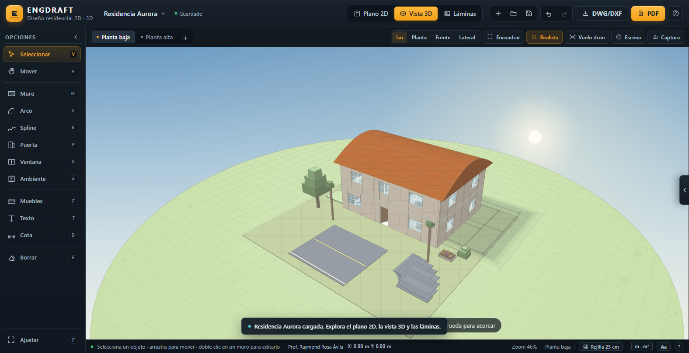

# EngDraft

**Planos de residencias en 2D y 3D, directo en el navegador.**
EngDraft es una aplicación HTML offline pensada para ingenieros civiles y diseñadores: dibuja la planta, inserta muros, puertas, ventanas, ambientes y mobiliario, revisa la maqueta 3D y entrega el juego de planos en PDF vectorial o DXF compatible con AutoCAD.

📘 **Manual completo:** [`manual/EngDraft-Manual.pdf`](manual/EngDraft-Manual.pdf) · versión editable en Word: [`manual/EngDraft-Manual.docx`](manual/EngDraft-Manual.docx). Incluye tutorial paso a paso, referencia de herramientas, 3D, láminas, archivos, buenas prácticas, ejercicios para estudiantes, FAQ y checklist de entrega.



## Abrir la aplicación

No requiere instalación, servidor ni internet.

1. Abre **`index.html`** con doble clic (Edge, Chrome, Firefox o Safari recientes).
2. La primera vez se carga **Residencia Aurora**, un proyecto demostración de dos niveles completamente amueblado.
3. Si quieres servirlo por HTTP (útil para pruebas):

```bash
python -m http.server 8765
# abre http://127.0.0.1:8765/
```

Todos los datos se dibujan y se guardan en tu equipo. No se envía nada a ningún servidor.

## Funciones principales

### Plano 2D
- Muros encadenados con espesor y altura editables, uniones automáticas y snapping a extremos, medios, vértices y rejilla.
- **Rejilla configurable**: separación de líneas, línea maestra, origen desplazado y un **paso de ajuste independiente** para dibujar con dimensiones exactas (por ejemplo rejilla de 25 cm y ajuste fino de 5 cm). Estilos de líneas o puntos, rejilla adaptativa al zoom y ejes del origen. Se abre con `Shift+G`, con el botón **Rejilla** del lienzo o desde la barra de estado; la configuración se guarda en el proyecto y se puede deshacer con `Ctrl+Z`.
- **Letra más legible**: escala tipográfica de la interfaz y control **Aa** en la barra de estado con tres tamaños (Normal, Grande y Muy grande). La preferencia queda recordada en este navegador.
- Puertas y ventanas insertadas sobre el muro, con abanico, jambas, vidrio y antepecho. Puedes **girar la hoja, invertir la bisagra** y editar ancho, alto, posición y antepecho.
- **Sistema métrico o imperial** conmutable desde la barra de estado o Datos del proyecto: m / m² o ft / ft² en cotas, áreas, propiedades, láminas y 3D.
- Ambientes con nombre, acabado, color y **área calculada**; detección automática de recintos cerrados.
- Biblioteca de **más de 40 muebles y accesorios** de sala, cocina, baño, dormitorio y exterior.
- Cotas manuales y cotas generales automáticas, textos, norte, rejilla adaptativa, capas con visibilidad y bloqueo.
- Selección, arrastre, rotación, duplicado, borrado, deshacer/rehacer y edición numérica de cada objeto.
- Niveles ilimitados con pestañas de planta.

La rejilla se ajusta desde su propio cuadro (`Shift+G`) y la letra de la interfaz desde el control **Aa** de la barra de estado.





### Vista 3D
- Renderizador propio sobre Canvas 2D (sin WebGL ni librerías externas): perspectiva orbital, iluminación, sombras suaves y cielo.
- Muros con huecos reales de puertas y ventanas, vidrios, dinteles y antepechos.
- Pisos por ambiente, mobiliario 3D, techo opcional, etiquetas de ambiente y captura PNG de alta resolución para las láminas.
- Presets **Iso / Planta / Frente / Lateral**, encuadre automático, filtro de nivel activo o ambos niveles.
- Órbita con arrastre, desplazamiento con botón derecho/Shift, rueda para zoom y doble clic para encuadrar.

### Láminas y PDF
- **4 cajetines profesionales**: Moderna, Clásica, Técnica y Municipal, con logo, proyecto, cliente, ubicación, ingeniero, licencia, escala, fecha, revisión, nivel, título y número de lámina.
- Tamaños **A4, A3, A2, A1, Letter y Tabloid**, horizontal o vertical.
- Contenidos: planta del nivel, notas y cuadros, portada y vista 3D con captura.
- Escala fija si cabe; si no cabe, se ajusta automáticamente y se anota la escala efectiva.
- Exportación **PDF vectorial** (no rasteriza el plano), una página por lámina, con acentos y símbolos españoles.



### Archivos
- **Guardar / abrir** proyectos `.engdraft` (JSON legible) con todos los niveles, objetos, capas y láminas.
- Arrastrar y soltar un `.engdraft` o `.json` sobre la aplicación también lo abre.
- Autoguardado en el navegador.
- Exportar **DXF ASCII R12** en milímetros para AutoCAD, LibreCAD, BricsCAD y otros CAD.
- Exportar **PDF** de todo el juego de planos.

> **Sobre DWG:** el navegador no puede escribir el formato binario propietario `.dwg`. EngDraft exporta **DXF R12**, el formato de intercambio estándar de AutoCAD. Abre el `.dxf` en AutoCAD y usa *Guardar como → DWG* si necesitas ese formato. La interfaz lo etiqueta como **DWG/DXF** y muestra esta explicación al exportar.

## Flujo de trabajo recomendado

1. **Muro (M)**: dibuja el perímetro y los tabiques con clics; `Esc` termina.
2. **Puerta (P) / Ventana (N)**: haz clic sobre un muro para insertar la abertura.
3. **Detectar ambientes**: cierra los recintos y pulsa el botón; se crean con área.
4. **Mueble (F)**: elige un accesorio de la biblioteca y haz clic en el plano; `R` rota 90°.
5. **Texto (T), Cota (D)**: añade anotaciones y acotaciones.
6. **Vista 3D (2)**: revisa la maqueta y captura una imagen si quieres incluirla en una lámina.
7. **Láminas (3)**: configura tamaño, cajetín, escala y contenido.
8. **PDF** o **DWG/DXF**: exporta el entregable. Guarda el `.engdraft` para conservar el proyecto editable.

## Atajos

| Acción | Tecla |
|---|---|
| Seleccionar / Mover vista | `V` / `H` |
| Muro / Puerta / Ventana | `M` / `P` / `N` |
| Ambiente / Mobiliario | `A` / `F` |
| Texto / Cota / Borrar | `T` / `D` / `E` |
| Terminar o salir | `Esc` |
| Deshacer / Rehacer | `Ctrl+Z` / `Ctrl+Y` |
| Guardar proyecto / Abrir | `Ctrl+S` / `Ctrl+O` |
| Nuevo proyecto / Duplicar mueble | `Ctrl+N` / `Ctrl+D` |
| Alternar rejilla / snap / orto | `G` / `S` / `O` |
| Configurar rejilla y paso de ajuste | `Shift+G` |
| Rotar mueble seleccionado | `R` |
| Ajustar vista | `Shift+F` o `Home` |
| Vistas 2D / 3D / Láminas | `1` / `2` / `3` |
| Zoom | `+` / `−` |
| Ayuda | `?` o `F1` |

## Estructura

```
index.html                  Entrada de la aplicación
css/app.css                 Interfaz oscura y responsiva
js/geometry.js              Geometría, snapping y detección de ambientes
js/library.js               Catálogo de mobiliario (plantas + cajas 3D)
js/templates.js             Plantillas y proyecto demostración
js/store.js                 Estado, historial, selección y autoguardado
js/editor2d.js              Editor de planta
js/view3d.js                Renderizador 3D sobre Canvas 2D
js/sheets.js                Cajetines, backend Canvas/PDF y PDF vectorial
js/dxf.js                   Exportador DXF R12
js/app.js                   Orquestación de la interfaz
samples/                    Proyecto, PDF y DXF de ejemplo
docs/                       Capturas de la aplicación
tests/                      Pruebas de humo con Node
```

## Muestras incluidas

- `samples/Residencia-Aurora.engdraft` — proyecto editable de dos niveles.
- `samples/Residencia-Aurora-planos.pdf` — 4 láminas A3 (plantas, notas y portada).
- `samples/Residencia-Aurora.dxf` — plano en DXF R12 para AutoCAD.

## Pruebas

Con Node disponible:

```bash
node tests/test-core.js      # geometría, biblioteca, plantillas, store (rejilla), DXF
node tests/test-grid.js      # rejilla configurable del editor 2D: ajuste, saneado y render
node tests/test-sheets.js    # previews Canvas y PDF vectorial (xref/páginas)
node tests/test-view3d.js    # renderizador 3D con canvas simulado
node tests/make-samples.js   # regenera las muestras
```

Las pruebas de navegador se hicieron contra Microsoft Edge (Chromium) servido por HTTP y también abriendo `index.html` directamente.



## Privacidad y guardado

- Todo el procesamiento es local; no hay peticiones de red ni dependencias CDN.
- El autoguardado usa `localStorage`. Algunos navegadores restringen `localStorage` en `file://`; en ese caso la interfaz avisa *Sin autoguardado*. Descarga el `.engdraft` para conservar tu trabajo.
- No se recopilan datos, cuentas ni telemetría.

## Limitaciones conocidas

- **DWG nativo:** no se genera el binario propietario; se entrega DXF compatible y se explica cómo guardarlo como DWG en AutoCAD.
- El techo 3D es una losa sobre la envolvente superior; en plantas irregulares puede quedar algún voladizo.
- La vista 3D prioriza claridad: sin texturas fotorrealistas ni *picking* de objetos.
- El PDF no comprime los flujos de imagen de la captura 3D; un juego con capturas puede pesar unos MB.
- La aplicación está pensada para escritorio; en pantallas pequeñas se recomienda 1280 px de ancho o más.

---

**EngDraft 1.1** · HTML + CSS + JavaScript clásico · sin dependencias externas · funciona offline.

**Autor:** Prof. Raymond Rosa Ávila.
